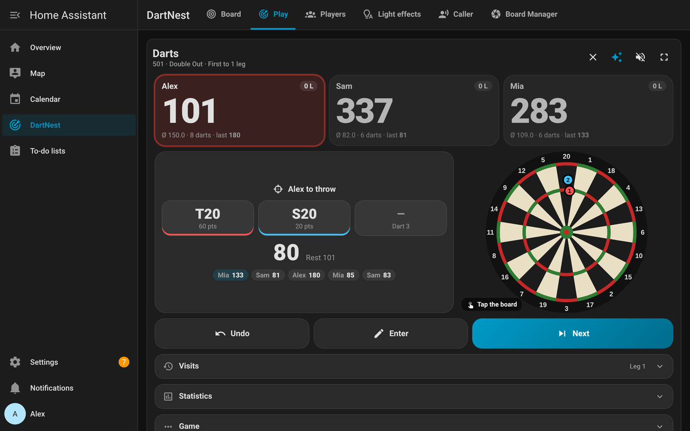
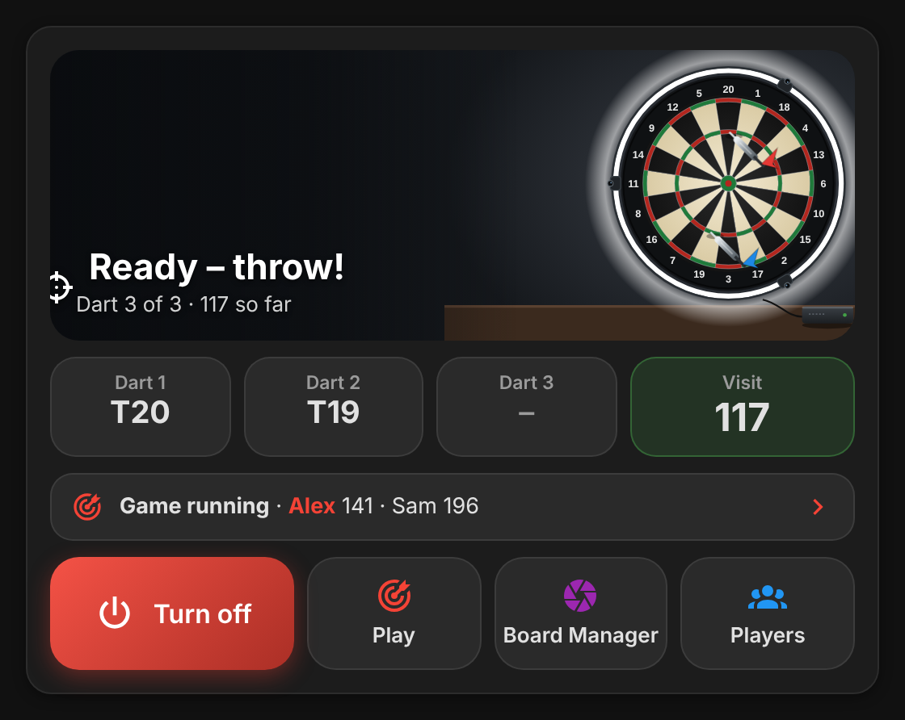
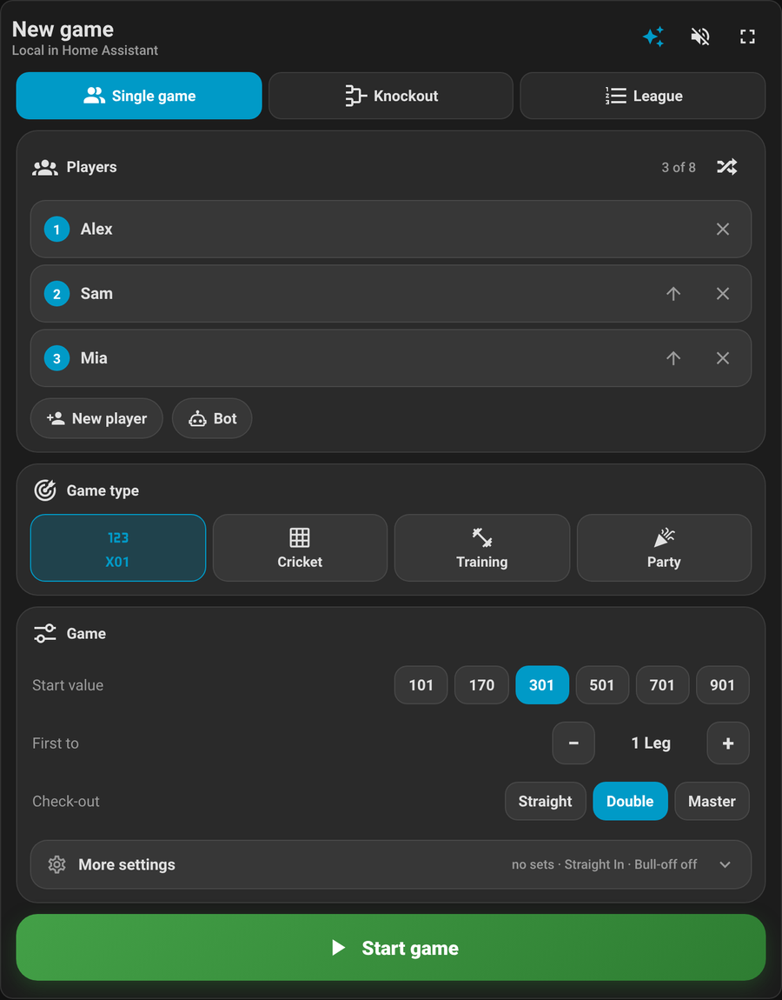
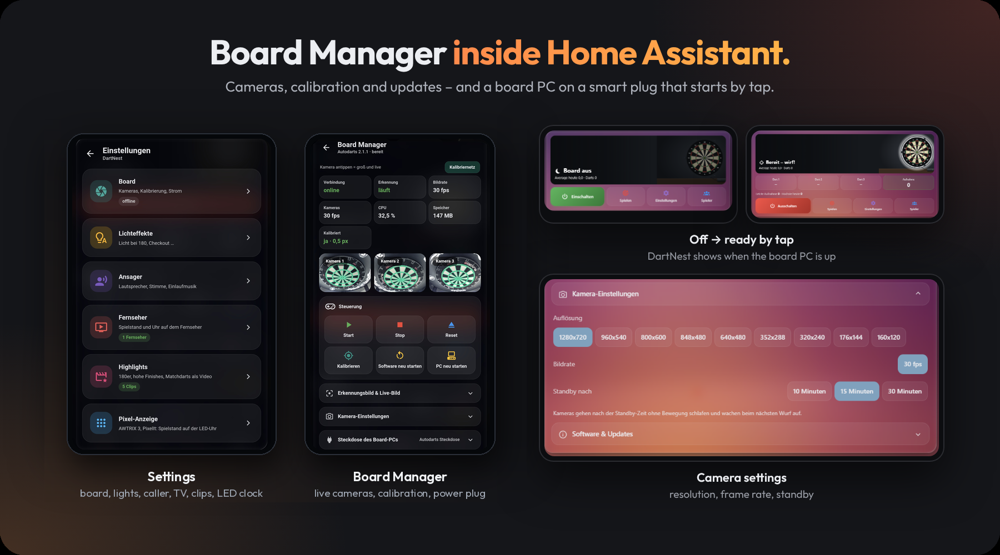
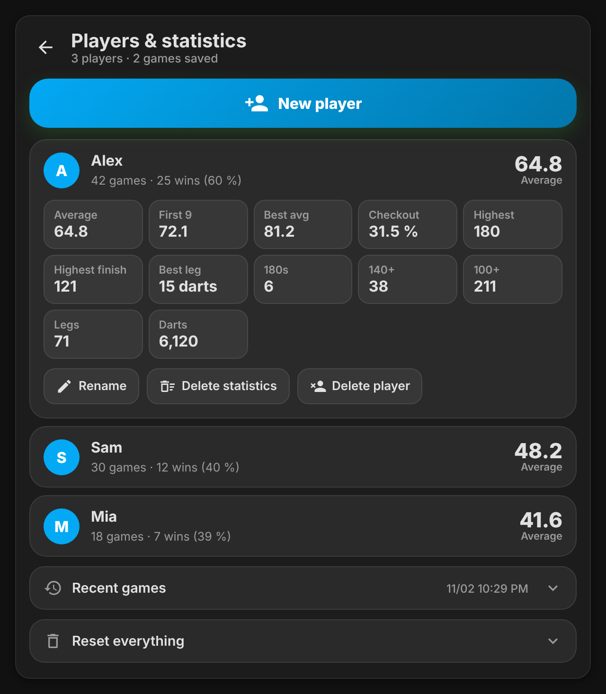

<p align="center">
  <picture>
    <source media="(prefers-color-scheme: dark)" srcset="https://raw.githubusercontent.com/Wadim-dev/Autodarts_ha/main/docs/dark_logo.png">
    
  </picture>
</p>

<h1 align="center">Autodarts for Home Assistant</h1>

<p align="center">
  Your Autodarts board in Home Assistant – fully local, with X01, Cricket, training and party games, players, bots, statistics, effects and ready-made dashboard cards.
</p>

<p align="center">
  <a href="https://github.com/Wadim-dev/Autodarts_ha/releases"></a>
  <a href="https://github.com/Wadim-dev/Autodarts_ha/actions/workflows/validate.yml"></a>
  
  
  
  <a href="LICENSE"></a>
</p>

<p align="center">
  
</p>

> **Unofficial project.** Not affiliated with, endorsed or supported by Autodarts. The name "Autodarts" is only used to describe compatibility.

---

## Contents

- [Highlights](#highlights)
- [Dashboard cards](#dashboard-cards)
- [Use cases](#use-cases)
- [Supported devices](#supported-devices)
- [Requirements](#requirements)
- [Installation](#installation)
- [Configuration](#configuration)
- [Entities](#entities)
- [Local games](#local-games)
- [Actions](#actions)
- [Automation examples](#automation-examples)
- [How it works](#how-it-works)
- [Known limitations](#known-limitations)
- [Troubleshooting](#troubleshooting)
- [FAQ](#faq)
- [Removal](#removal)
- [Deutsch](#deutsch)

## Highlights

| | |
|---|---|
| 🏠 **100 % local** | Talks directly to the Autodarts Board Manager on your board PC. No cloud, no account, no internet needed. |
| 🎯 **Live darts** | Every dart with field (e.g. `T20`) and exact position on the board, the current visit and the board status – updated every second. |
| 🏆 **Complete X01 game** | 101 to 901, straight / double / master in and out, legs and sets, bull-off, 1–8 players, bots with adjustable average. |
| 🎯 **Cricket, training and party games** | Cricket (standard, cut-throat, no score; 15–20, 10–20, random), Around the Clock, Bob's 27, doubles, 121 checkout, highscore, Shanghai, Killer, Halve-It, Golf, Baseball – with rule text, target on the board and bots. |
| ✏️ **Correct anything** | Undo, add, change or delete any dart of any visit – the whole score is recalculated automatically. |
| 📊 **Statistics** | Per player: average, first 9, checkout rate, highest score, highest finish, best leg, 180s / 140+ / 100+, wins, history. |
| 📷 **Cameras** | All three board cameras, detection image and live image, with the calibration grid drawn over the camera images. |
| 🛠️ **Board Manager in HA** | Start/stop detection, reset, calibrate, restart, camera resolution / frame rate / standby, board software updates. |
| 🧩 **Dashboard cards included** | Four polished cards are installed with the integration – no extra download, no resource to add. |
| 🔌 **Works with a smart plug** | Switch the board PC off whenever you like. The integration shows `Offline` and continues on its own when the board is back. |
| 🌍 **English and German** | Entities, errors and cards follow your Home Assistant language. |

## Dashboard cards

The cards are part of the integration and are loaded automatically in every dashboard. Add them with **Edit dashboard → Add card → search "Autodarts"** or in YAML.

<table>
  <tr>
    <td width="50%"></td>
    <td width="50%"></td>
  </tr>
  <tr>
    <td><b>Overview</b> – animated board scene with the darts where they landed, current visit, running game and optional power button.</td>
    <td><b>Game – lobby</b> – pick players and bots, start value, legs/sets, check-in/out and bull-off.</td>
  </tr>
  <tr>
    <td></td>
    <td></td>
  </tr>
  <tr>
    <td><b>Board Manager</b> – camera images with calibration grid, system values, controls, camera settings and updates.</td>
    <td><b>Players</b> – create and rename players, detailed statistics, recent games.</td>
  </tr>
</table>

### Game card

The game card is made for a tablet next to the board (full screen button included):

- big scores, average and checkout suggestions for every player
- the current visit with the three darts, entered by the board or by tap
- the board as graphic **or as straightened live camera image** (tap the board to switch camera 1/2/3/graphic, "Grid" shows the calibration grid)
- visit history – tap any visit to correct it
- live statistics and the result screen with rematch
- optional **caller**: announces scores, "One hundred and eighty!", checkouts and what you require (browser speech, English or German)
- keeps the screen awake during a game
- **effects** for what happens at a real board: dart flight with wobble, sparks on trebles and doubles, bull flash, "MISS" falling off, board jolt; big scenes for 180 (spotlights, shockwave, confetti), ton-forty, ton, three in a bed, bed & breakfast, no score (tumbleweed), bust (cracks and stamp), game shot, high finish, 170 "big fish", set, match (fireworks and trophy) and the nine-darter (rainbow). Sounds play only while the caller is on. The ✨ button switches effects off per device; they respect "reduce motion" and stop while the card is hidden.

### Card options

All options are optional. Entities of the integration are found automatically.

```yaml
type: custom:autodarts-overview-card
game_path: /dashboard-darts/game        # shortcut buttons (shown only when set)
manager_path: /dashboard-darts/manager
players_path: /dashboard-darts/players
power_on: script.dartboard_on           # power button: script, switch, button or automation
power_off: script.dartboard_off
power_switch: switch.dartboard_plug     # smart plug, used for the "starting / shutting down" scene
power_sensor: sensor.dartboard_plug_power
pc_online: binary_sensor.dartboard_pc   # e.g. a ping or MQTT sensor of the board PC
info:                                   # small text in the scene
  - entity: sensor.darts_today
    name: Darts today
details:                                # line under the live darts
  - entity: input_number.highest_visit_today
    name: Highest today
```

```yaml
type: custom:autodarts-game-card
back_path: /dashboard-darts/0           # back arrow; without it the arrow goes back in history
power_on: script.dartboard_on           # "Turn on" button when the board is off
hide_elements: ["#bottom-bar"]          # hide elements of your dashboard while the game is shown
effects: false                          # no effects and no ✨ button
```

```yaml
type: custom:autodarts-manager-card
pc_restart: button.dartboard_pc_restart # adds a "Restart PC" button
```

```yaml
type: custom:autodarts-players-card
```

`back_button: false` hides the back arrow on the three page cards.

## Use cases

- **Play at home without a screen:** start an X01 game from the dashboard on a tablet next to the board; scores, checkout ways and statistics update with every dart.
- **Switch the board on and off with the room:** power the board PC with a smart plug, switch it on when you enter the room and off when the board has been idle for a while.
- **Celebrate:** flash the lights on a 180, play a sound on a checkout, announce the remaining score on a speaker.
- **Keep an eye on the hardware:** get a notification when calibration drifts, a camera drops frames or a board software update is available.
- **Track progress:** long-term statistics per player, including bots as training partners.

## Supported devices

| Device | Status |
|--------|--------|
| Autodarts board with **Board Manager 2.x** (local API on port 3180) | Supported, tested |
| Autodarts board with **Board Manager 1.x** | Supported (older state format is read as well) |
| Board Manager on Linux PC, mini PC, Raspberry Pi or Windows | Supported – only the network address matters |
| Other e-dartboards (Granboard, Scolia …) | Not supported |

One config entry is one board.

## Requirements

- Home Assistant **2026.2** or newer
- An Autodarts board (Board Manager 1.x or 2.x) reachable in your network, default port **3180**

## Installation

### HACS / Marketplace (recommended)

[](https://my.home-assistant.io/redirect/hacs_repository/?owner=Wadim-dev&repository=Autodarts_ha&category=integration)

1. Open HACS → three dots → **Custom repositories** → add `https://github.com/Wadim-dev/Autodarts_ha` as type **Integration**.
2. Search for **Autodarts**, download it and restart Home Assistant.

### Manual

1. Download the latest [release](https://github.com/Wadim-dev/Autodarts_ha/releases).
2. Copy `custom_components/autodarts` into the `custom_components` folder of your Home Assistant configuration.
3. Restart Home Assistant.

## Configuration

[](https://my.home-assistant.io/redirect/config_flow_start/?domain=autodarts)

Boards with Board Manager 2.x announce themselves in the network: Home Assistant shows **Autodarts board found** under **Settings → Devices & services** – just confirm. Otherwise add it by hand: **Settings → Devices & services → Add integration → Autodarts.** The board must be switched on during setup.

| Parameter | Description |
|-----------|-------------|
| Host | IP address or host name of the board PC, e.g. `192.168.1.50` |
| Port | Port of the Board Manager, default `3180` |

There are no further options. To change the address later, use **three dots → Reconfigure** on the integration. If the board gets a new IP address and announces itself, the integration follows it automatically (only if the old address no longer answers).

**Data updates:** game state every second (every 30 s while the board is off), system values every 15 s, calibration points only after a new calibration, camera images only while they are shown.

## Entities

All entities belong to the device **Autodarts Board**. Entity IDs below are for an English installation.

| Entity | Description |
|--------|-------------|
| `sensor.autodarts_board_connection` | `Online` / `Offline` |
| `sensor.autodarts_board_status` | Board status: `throw`, `takeout`, `calibrating`, `starting`, `stopped` … (`Offline` while off) |
| `sensor.autodarts_board_event` | Last event of the board *(disabled by default)* |
| `sensor.autodarts_board_throw_1` … `_3` | Field of dart 1–3 (`T20`, `D16`, `S25`, `D25`, `M`), attributes: points, number, multiplier, position `x`/`y`, bouncer |
| `sensor.autodarts_board_current_visit` | Points of the current visit |
| `sensor.autodarts_board_number_of_throws` | Darts on the board *(disabled by default)* |
| `binary_sensor.autodarts_board_detection_running` | Detection is running |
| `sensor.autodarts_board_game` | Local game: `idle` / `bull_off` / `running` / `finished` (shown translated), everything else as attributes (players, scores, checkout, visits, statistics) |
| `event.autodarts_board_game_event` | Fires on game events: `dart`, `triple`, `bull`, `bullseye`, `visit`, `ton`, `ton_forty`, `one_eighty`, `no_score`, `bust`, `three_in_a_bed`, `checkout`, `high_finish`, `nine_darter`, `leg_won`, `set_won`, `match_won`, and for the other games `nine_marks`, `shanghai`, `killer`, `eliminated`, `halved`, `hole_in_one`, plus `tournament_won`; attributes `player` and, depending on the event, `field`/`points` (darts), `score`/`darts`/`remaining` (visits) or `finish` (checkouts) |
| `sensor.autodarts_board_players` | Number of players, attributes with all players, statistics and recent games |
| `camera.autodarts_board_camera_1` … `_3` | Board cameras (attribute `kalibrierung` with the calibration points) |
| `camera.autodarts_board_detection_image`, `_live_image` | Detection image and live image |
| `button.autodarts_board_start_detection`, `_stop_detection`, `_reset_throws` | Controls |
| `button.autodarts_board_calibrate`, `_restart_board_software` | Configuration |
| `select.autodarts_board_camera_resolution`, `_camera_frame_rate_setting`, `_camera_standby` | Camera settings |
| `update.autodarts_board_board_software` | Board software version, install updates |
| `sensor.autodarts_board_cpu_load`, `_memory`, `_frame_rate`, `_camera_frame_rate`, `_calibration_deviation`, `_board_software` | Diagnostics |

While the board is off, connection and status show `Offline`; all other board entities are *unavailable*. The game and player sensors always stay available.

## Local games

All games run completely inside Home Assistant: X01, Cricket, five training games and five party games, for 1–8 players, people and bots mixed. The game card shows a short rule text for every game, highlights the current target on the board and has its own effects (nine marks, Shanghai, killer, hole in one …).

| Game | `spiel` | Rules in short | Options |
|------|---------|----------------|---------|
| X01 | `x01` | 101 … 901, see below | start value, in/out, legs, sets |
| Cricket | `cricket` | Close 15–20 and bull with three marks; extra marks score while an opponent has the number open | `variante`: `standard`, `cut_throat` (points go to the opponents, lowest wins), `no_score`; `zahlen`: `classic` (15–20), `tactics` (10–20), `random` |
| Around the Clock | `atc` | 1 to 20, then bull; first through wins | `variante`: `single` (any segment), `double`, `triple` |
| Bob's 27 | `bobs27` | Start 27; three darts at D1 … D20 and bull; hits add, no hit subtracts; below 0 you are out | – |
| Doubles | `doppel` | Three darts at every double, one point per hit | – |
| 121 Checkout | `checkout121` | Nine darts to check out (double out); done +1, missed −1 | `runden` (attempts, default 10) |
| Highscore | `highscore` | Most points in N visits | `runden` (default 10) |
| Shanghai | `shanghai` | Round n counts number n; single, double and treble in one visit wins at once | `runden`: 7 or 20 |
| Killer | `killer` | Hit your double to become a killer, then take the lives of the others with their double | `leben` (default 3) |
| Halve-It | `halve_it` | 15, 16, any double, 17, 18, any treble, 19, 20, bull; no hit halves your score | – |
| Golf | `golf` | Hole n = number n; last dart counts (treble 1, double 2, single 3, miss 5); fewest strokes win | `runden`: 9 or 18 holes |
| Baseball | `baseball` | Nine innings, inning n = number n; single 1, double 2, treble 3 runs | – |

Every game can be played as first to N legs.

### Without cameras: tap or type

Tap **Tap the board** under the board in the game card and tap the spot where the dart landed (outside the double ring = miss). It switches on by itself while the board is offline and is remembered per device. On a keyboard type `T20`, `D16`, `S5`, `25`, `50` (or `B`) or `0` (or `M`) and press Enter; Enter alone finishes the visit, Backspace undoes the last dart.

### Voice (Assist)

The integration registers sentences in German, English and Russian, nothing to set up. They also work with an AI conversation agent, because sentence triggers are checked first.

| Command | Examples |
|---------|----------|
| Score | "Wie steht es beim Darts", "Who is winning at darts", "Какой счёт в дартс" |
| Ranking | "Wer ist der beste beim Darts", "Darts ranking", "Кто лучший в дартс" |
| Start / rematch | "Starte Darts 501", "Starte Darts Cricket", "Start a darts rematch", "Начни дартс шанхай" |
| Next tournament match | "Nächstes Darts Match", "Next darts match" |
| Undo / cancel | "Darts rückgängig", "Darts Spiel abbrechen", "Cancel the darts game" |

### Tournament

For 3–16 players (bots too) the lobby offers **Tournament** next to single game: a knockout bracket with byes for the top seeds, every match played with the same game and settings. The card shows the round above the match ("Semi-final · Match 1 of 2"), the bracket after each match with a button for the next one, and a champion celebration at the end. Undo after a match takes its result back. The tournament is stored, so it survives restarts; it can be cancelled any time. The event `tournament_won` fires with the champion.

### Statistics and badges

The players card shows for every player: rating (Elo, also against bots), streak of days played, X01 key figures, a **hit map** of all fields (or the darts as dots, where the board detected a position) with the most hit fields, the **trend** of the X01 average over the last games, **badges** in bronze, silver and gold (180s, 100+ visits, high finish, short leg, best average, wins, games, darts, days in a row, nine marks, Shanghai, hole in one, allrounder) and the **head to head** record against every other player. A ranking by rating and a CSV export of all statistics are below the players. The game card shows the last visits of everybody next to the board. Statistics of Cricket, training and party games are kept per game (games, wins, best result; Cricket: best MPR) and shown on the players card.

### X01

The game runs completely inside Home Assistant and is stored in `.storage/autodarts.spiel`, so it survives restarts.

- **Players**: up to 8 per game, any mix of people and bots. Bots throw with a realistic scatter for the chosen average (20–120).
- **Modes**: start value 101, 170, 301, 501, 701, 901; check-in and check-out `straight`, `double` or `master`; first to N legs or N sets of M legs.
- **Bull-off**: closest dart to the bull starts; ties throw again.
- **Darts from the board** are counted automatically. Pulling the darts finishes the visit. Without the board (or for corrections) darts can be entered by hand.
- **Checkout suggestions** for up to three darts, respecting the check-out mode.
- **Statistics** are added to each player when a game ends; undo after the end takes them back again.

## Actions

| Action | Description |
|--------|-------------|
| `autodarts.spiel_starten` | Start a game. Fields: `spiel` (see table above, default `x01`), `variante`, `zahlen`, `runden`, `leben`, `spieler` (list of player IDs, bots as `bot:55`, up to 8), `startwert`, `einwurf`, `auswurf` (`straight`/`double`/`master`), `legs`, `sets`, `bull_off`. Without fields the last settings and players are used (rematch). |
| `autodarts.spiel_abbrechen` | Cancel the running game (not counted). |
| `autodarts.turnier_starten` | Start a knockout tournament with 3–16 `spieler`; same fields as `spiel_starten`, used for every match. Starts the first match. |
| `autodarts.turnier_weiter` | Start the next match of the tournament. |
| `autodarts.turnier_abbrechen` | End the tournament (bracket is removed). |
| `autodarts.weiter` | Finish the current visit; missing darts count as miss. |
| `autodarts.rueckgaengig` | Undo the last dart (also after the end of a game). |
| `autodarts.wurf_aendern` | Correct, add or delete a dart: `aufnahme` (visit index, empty = current), `dart` (0–2), `feld` (`T20`, `D16`, `25`, `Bull`, `M`; empty deletes). |
| `autodarts.spieler_anlegen` | Create a player (`name`); returns `{"id": …}`. |
| `autodarts.spieler_aendern` | Rename (`name`) or delete (`loeschen: true`) a player by `id`. |
| `autodarts.statistik_loeschen` | Delete statistics of one player (`id`) or of all players; `verlauf: true` also clears the game history. |

Player IDs are listed in the attributes of `sensor.autodarts_board_players`. Wrong input (unknown field, no game running …) returns a clear, translated error message.

## Automation examples

**Flash the lights on a 180**

```yaml
triggers:
  - trigger: state
    entity_id: event.autodarts_board_game_event
    attribute: event_type
    to: one_eighty
actions:
  - action: light.turn_on
    target:
      entity_id: light.living_room
    data:
      flash: long
```

This triggers when the event type changes to `one_eighty`. To react to every 180, also two in a row, trigger on any state change of the entity and check the type:

```yaml
triggers:
  - trigger: state
    entity_id: event.autodarts_board_game_event
    not_from: unavailable
conditions:
  - condition: state
    entity_id: event.autodarts_board_game_event
    attribute: event_type
    state: one_eighty
```

The same works for every other moment, e.g. `match_won`, `bust` or `nine_darter`.

**Announce a 180 on your speakers**

```yaml
triggers:
  - trigger: state
    entity_id: sensor.autodarts_board_current_visit
    to: "180"
actions:
  - action: tts.speak
    target:
      entity_id: tts.home_assistant_cloud
    data:
      media_player_entity_id: media_player.living_room
      message: One hundred and eighty!
```

**Switch on the light at the board when detection starts**

```yaml
triggers:
  - trigger: state
    entity_id: binary_sensor.autodarts_board_detection_running
    to: "on"
actions:
  - action: light.turn_on
    target:
      entity_id: light.dartboard
```

**Start a 501 rematch with a button**

```yaml
actions:
  - action: autodarts.spiel_starten
```

**Start a Cricket game against a bot**

```yaml
actions:
  - action: autodarts.spiel_starten
    data:
      spiel: cricket
      variante: cut_throat
      spieler: ["a1b2c3d4", "bot:60"]
```

**Start a game against a bot**

```yaml
actions:
  - action: autodarts.spiel_starten
    data:
      spieler: ["a1b2c3d4", "bot:60"]
      startwert: 501
      auswurf: double
      legs: 3
```

**Notify the winner**

```yaml
triggers:
  - trigger: state
    entity_id: sensor.autodarts_board_game
    to: finished
actions:
  - action: notify.notify
    data:
      message: >
        
        {{ a[state_attr('sensor.autodarts_board_game', 'gewinner')].name }} wins!
```

## How it works

```
Board PC (Autodarts Board Manager, port 3180)
   │  GET /api/state every second · /api/system every 15 s · camera images on demand
   ▼
Home Assistant ── Autodarts integration ── entities, actions, local games (.storage)
   ▼
Dashboard cards (loaded automatically) · automations · voice assistants
```

Only the documented local endpoints of the Board Manager are used. Camera images are only fetched while a card or the more-info dialog shows them.

## Known limitations

- Games started in the Autodarts app are not imported (the Autodarts cloud is not used at all).
- The integration **polls** the Board Manager every second; there is no push connection yet.
- Camera settings depend on what the board's cameras report; some boards only offer one resolution or frame rate.
- One board per Home Assistant installation.
- The live camera stream is MJPEG from the board PC and uses its CPU while it is open.

## Troubleshooting

| Problem | Solution |
|---------|----------|
| Setup says the Board Manager does not answer | Switch the board PC on, open `http://<ip>:3180` in a browser to check it, and make sure Home Assistant can reach that address. |
| Everything shows `Offline` / unavailable | The board PC is off or not reachable. The integration reconnects automatically within 30 seconds. |
| Cameras are black | Detection is stopped – press **Start**. The cameras only deliver images while detection runs. |
| Calibration grid is missing | The board is not calibrated yet, or the calibration points could not be read. Calibrate once in the Board Manager card. |
| Cards are not found | Restart Home Assistant after installing, then reload the browser (clear the app cache on phones). |
| Darts are not counted in the game | Check that `sensor.autodarts_board_throw_1` changes when you throw. Darts are ignored while a bot is throwing. |

For a bug report, download the diagnostics (**Settings → Devices & services → Autodarts → three dots → Download diagnostics**). The board address and host name are removed automatically.

To get debug logs:

```yaml
logger:
  logs:
    custom_components.autodarts: debug
```

## FAQ

**Does it need the Autodarts cloud or a subscription?** No. Everything runs locally between Home Assistant and your board PC.

**Can I still use the Autodarts app?** Yes. The integration only reads the Board Manager; games in the app are not affected. The local games in Home Assistant are independent of the app.

**Can I switch the board PC off with a smart plug?** Yes, that is the intended use. Use the `power_*` options of the overview card for a power button with a nice start-up animation.

**Is my data shared?** No. Players, statistics and games stay in your Home Assistant.

## Removal

1. **Settings → Devices & services → Autodarts → three dots → Delete.**
2. If installed with HACS, remove it in HACS as well, then restart Home Assistant.
3. Players, statistics and history are stored in `.storage/autodarts.spiel`; delete this file if you want to remove them too.

## Contributing

Issues and pull requests are welcome. The repository runs hassfest, the HACS check and the test suite (99 % coverage), ruff and mypy --strict on every push.

## License

[MIT](LICENSE)

---

## Deutsch

**Autodarts für Home Assistant** – inoffizielle, komplett lokale Integration für ein Autodarts-Board.

- Live-Würfe mit Feld und Position, Board-Status, Kameras mit Kalibriernetz, Board Manager in Home Assistant
- Lokale Spiele für 1–8 Spieler, mit Bots: X01 (Double/Master In und Out, Legs und Sets), Cricket (Standard, Cut-Throat, ohne Punkte; 15–20, 10–20, Zufall), Training (Rund um die Uhr, Bob's 27, Doppel, 121 Checkout, Highscore) und Partyspiele (Shanghai, Killer, Halve-It, Golf, Baseball) – mit Regeltext, Ziel auf der Scheibe, Bull-Off, Korrekturen und Statistik
- Eingabe ohne Kameras: Scheibe antippen oder per Tastatur (T20 + Enter)
- Sprachbefehle für Assist auf Deutsch, Englisch und Russisch (Stand, Rangliste, Spiel starten, Rückgängig …)
- Turnier (K.-o.) für 3–16 Spieler mit Turnierbaum, Freilosen und Siegerfeier
- Spielerseite mit Wertung (Elo), Serie, Trefferbild, Trend, Abzeichen (Bronze/Silber/Gold), direktem Vergleich, Rangliste und CSV-Export
- Ereignis-Entität `event.autodarts_board_game_event` (180, Bust, Checkout, Leg/Satz/Spiel gewonnen, Neun-Darter …) für Automationen
- Effekte in der Spielkarte wie am echten Board: Pfeilflug, Funken, 180 mit Scheinwerfern und Konfetti, Überworfen mit Rissen, Game Shot, Feuerwerk beim Matchgewinn
- Vier fertige Dashboard-Karten werden automatisch mitgeladen (Übersicht, Spiel, Board Manager, Spieler) – Karten, Entitäten und Fehlermeldungen auf Deutsch, wenn Home Assistant auf Deutsch eingestellt ist
- Board-PC darf jederzeit aus sein (z. B. per Steckdose): Anzeige „Offline“, danach geht es von selbst weiter

**Installation:** HACS → Benutzerdefinierte Repositories → `https://github.com/Wadim-dev/Autodarts_ha` (Typ Integration) → Autodarts herunterladen → Home Assistant neu starten.
**Einrichtung:** Boards mit Board Manager 2.x werden automatisch gefunden („Autodarts Board gefunden“ unter Geräte & Dienste, nur bestätigen). Sonst: Einstellungen → Geräte & Dienste → Integration hinzufügen → Autodarts → IP-Adresse des Board-PCs (Port 3180). Das Board muss dabei eingeschaltet sein. Adresse später ändern: drei Punkte → Neu konfigurieren.

> Kein offizielles Projekt von Autodarts. Der Name dient nur zur Beschreibung der Kompatibilität.
